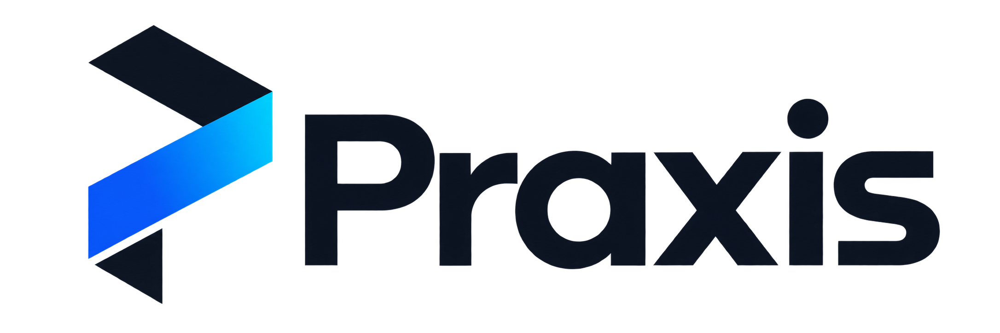
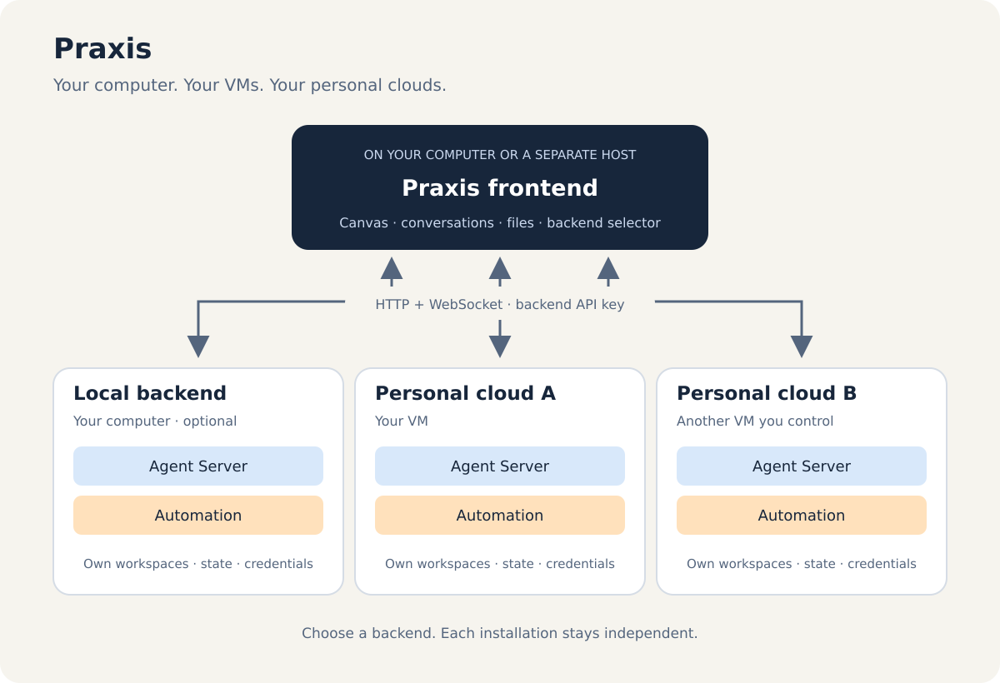

  <picture>
    <source media="(prefers-color-scheme: dark)" srcset="docs/assets/brand/praxis-primary-white.png">
    
  </picture>

# Praxis documentation

Praxis is a workspace for agent-assisted software development. Work with
conversations, files, terminals, browser sessions and automations in the Canvas,
while your backend runs the agents on infrastructure you control.

This `documentation` branch is the only home of the Praxis documentation. It is
independent of `main`: edit the Markdown files here through pull requests into
`documentation`; changes never run application CI. Source code lives on
[`main`](https://github.com/Praxiss-Lab/praxis).

## Get started

- [Installation](docs/getting-started.md): native, Docker and launch modes.
- [User guide](docs/USER_GUIDE.md): models, profiles, skills, MCP and automation.
- [Distribution](docs/distribution/README.md): complete, backend and frontend modes.
- [Self-hosting](docs/SELF_HOSTING.md): persistence, authentication and remote access.
- [Windows](https://github.com/Praxiss-Lab/praxis/blob/main/README.windows.md): Docker Desktop and WSL 2.
- [Kubernetes chart](https://github.com/Praxiss-Lab/praxis/blob/main/helm/agent-canvas/README.md): experimental persistent deployment.

## Concepts

- [Architecture](docs/architecture.md): frontend, backend and independent personal clouds.
- [ACP agents](docs/ACP_AGENTS.md): external agent configuration and credentials.
- [Cloud isolation](docs/CLOUD_ISOLATION.md) and [SDK independence](docs/SDK_INDEPENDENCE.md).
- [Telemetry](docs/TELEMETRY.md): configuration and maintenance.
- [DefenseClaw integration](docs/DefenseClaw.md).

## Develop

- [Development](docs/DEVELOPMENT.md): local development and verification.
- [Contributor agents, setup and commands](docs/AGENT_OPERATIONS.md).
- [Testing matrix](docs/TESTING_MATRIX.md) and [Canvas extensions testing](docs/CANVAS_EXTENSIONS_TESTING.md).
- [Visual identity](docs/BRAND.md): logo assets and the agreed palette.
- [API services](https://github.com/Praxiss-Lab/praxis/blob/main/src/api/README.md) and [themes](https://github.com/Praxiss-Lab/praxis/blob/main/src/themes/README.md).

## Maintain

- [Workflow responsibilities](docs/policies/WORKFLOWS.md), [issue triage](docs/policies/ISSUES.md).
- [Release policy](docs/policies/RELEASE.md) and [versioning](docs/policies/VERSIONING.md).
- [Repository cutover](docs/REPOSITORY_CUTOVER.md).
- [Upstream review](docs/upstream/README.md), [baseline](docs/upstream/BASELINE.md) and [sync log](docs/upstream/SYNC_LOG.md).

Praxis uses the [Praxis SDK](https://github.com/Praxiss-Lab/praxis-sdk) at a frozen commit.
Licensing and attribution are recorded in [LICENSE](https://github.com/Praxiss-Lab/praxis/blob/main/LICENSE)
and [NOTICE](https://github.com/Praxiss-Lab/praxis/blob/main/NOTICE). Hosted OpenHands Cloud is not used or supported.
